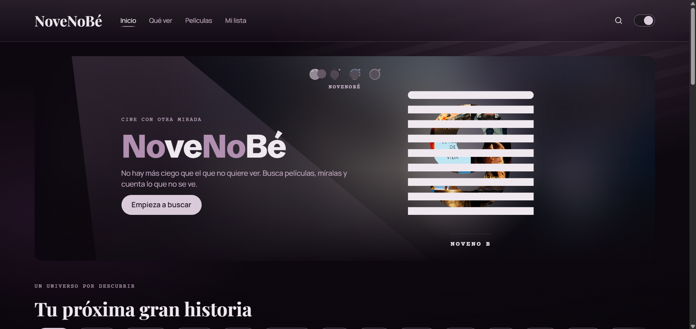
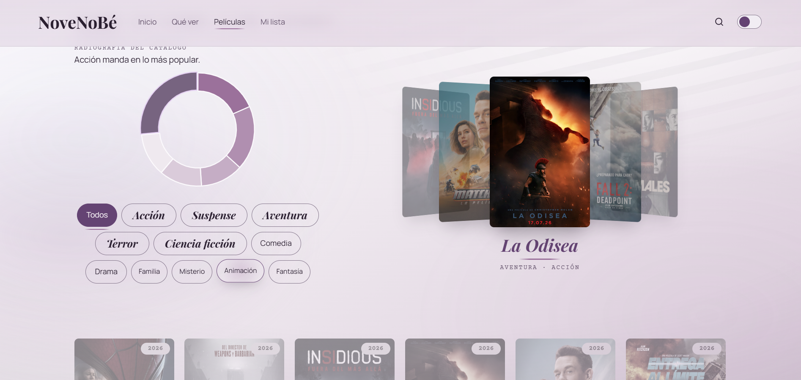
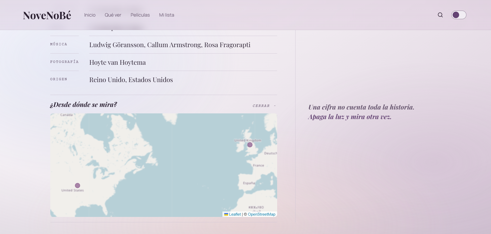
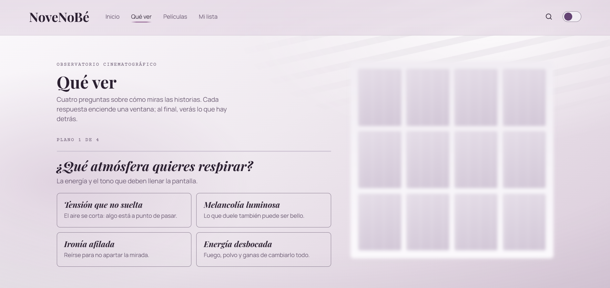

# NoveNoBé

> *No hay más ciego que el que no quiere ver.*

**NoveNoBé** es mi versión del proyecto integrador **CineData Explorer** (JavaScript avanzado · The Bridge): una SPA de cine para buscar películas con datos de **TheMovieDB**, ver en un **mapa Leaflet** dónde se produjeron y explorar sus géneros con **Chart.js**.

El concepto gira en torno a *ver / no ver*, con *La ventana indiscreta* de Hitchcock como referencia. El **tema claro** son las luces de la sala encendidas: la superficie, lo que se intuye. El **tema oscuro** es la revelación: se apagan las luces y aparece lo que estaba oculto.

🔗 **Demo:** _[enlace de GitHub Pages]_

---

## Capturas

| Inicio | Películas |
|---|---|
|  |  |

| Ficha con mapa | Qué ver |
|---|---|
|  |  |

---

## Funcionalidades

### Requisitos del proyecto
- **Buscador con debounce** (400 ms) y `async/await`. Cancela la petición anterior con `AbortController` y gestiona los errores con `try/catch`.
- **Clase `Movie`** (`js/Movie.js`): modela una película de TMDB y expone *getters* de presentación (`year`, `posterUrl`, `ratingText`, `genreNames`, `countryCodes`…).
- **Mapa Leaflet** (`js/map.js`) con un marcador por país de producción. TMDB da códigos ISO; las coordenadas salen de una tabla local de centroides (`data/paises.js`), así que el mapa no depende de otra API.
- **Doughnut de géneros** (`js/charts.js`) con datos reales del catálogo cargado. Sus colores salen de los tokens CSS y cambian con el tema.
- **Historial de las últimas 10 búsquedas** en `localStorage` (`js/storage.js`), sin repetidos y con la más reciente primero.

### Extras
- **Filtro por género** con funciones puras: las cápsulas y el propio anillo filtran la rejilla y el carrusel.
- **Paginación** con «Cargar más películas». Con un género elegido, pide páginas hasta reunir suficientes películas de ese género, con un tope de páginas.
- **Tema claro / oscuro persistido** en `localStorage`.
- **Carrusel 3D** de las películas más populares del género:
  - empieza en la película central;
  - se navega arrastrando (ratón y táctil), pulsando una vecina, con ← → o con las flechas;
  - una luz ambiental sigue al cursor.
- **Qué ver · Observatorio cinematográfico:** cuatro preguntas (atmósfera, mirada, ritmo y propuesta) y un recomendador determinista que explica cada sugerencia con coincidencias reales.
- **Mi lista:** las favoritas guardadas en `localStorage` (`novenobe_favoritos`), que además afinan las recomendaciones.
- **Ficha de película** con secciones enlazables (`#/pelicula/:id/:seccion`), reparto, equipo y certificación por edades.

---

## Tecnologías

- HTML5 semántico, CSS3 (custom properties, `color-mix`, `:has()`, transformaciones 3D) y **JavaScript vanilla con módulos ES6**. Sin frameworks.
- [TheMovieDB API](https://developer.themoviedb.org/) · [Leaflet 1.9](https://leafletjs.com/) · [Chart.js 4](https://www.chartjs.org/)
- Tipografías: Playfair Display, Manrope y Courier Prime (Google Fonts).

---

## Estructura

```
index.html
css/
  style.css          tokens de los dos temas, componentes y responsive
js/
  main.js            punto de entrada: orquesta los módulos y los eventos del DOM
  api.js             acceso a TMDB (todas las llamadas fetch) y ApiError
  Movie.js           clase Movie
  catalog.js         clase MovieCatalog: listas y paginación sin duplicados
  map.js             clase CountryMap (Leaflet)
  charts.js          clase CatalogCharts (doughnut de géneros)
  stage.js           clase GenreStage (carrusel 3D)
  hero.js            clase HeroCarousel (portada)
  que-ver.js         clase QueVer (cuestionario, resultados y Mi lista)
  recomendador.js    motor de recomendaciones (solo funciones puras)
  storage.js         localStorage: historial, tema y favoritas
  utils.js           funciones puras de filtrado y transformación
  router.js          rutas por hash (#/peliculas, #/pelicula/278…)
  tilt.js            inclinación de las tarjetas según el cursor
  scrollTheme.js     progreso de scroll
data/
  paises.js          centroides de países por código ISO
  movies.js          catálogo local de «Qué ver»
  avisos.js          avisos de la portada
img/
```

---

## Instalación

```bash
git clone https://github.com/coralormad/NoveNoBe.git
cd NoveNoBe
cp js/config.example.js js/config.js
```

1. Abre `js/config.js` y pega tu **Access Token v4** de TMDB (*Settings → API* en themoviedb.org).
2. Sirve la carpeta con un servidor local, porque los módulos ES no funcionan con `file://`. Por ejemplo, con **Live Server** de VS Code o con `npx serve .`.

---

## Decisiones técnicas

- **Programación orientada a objetos:** `Movie` modela los datos y los presenta con *getters*. `MovieCatalog`, `CountryMap`, `CatalogCharts`, `GenreStage`, `HeroCarousel` y `QueVer` encapsulan su estado con campos privados (`#`).
- **Asincronía:** todas las peticiones pasan por un único `request()` en `api.js`. Tiene `try/catch`, un error propio `ApiError` con el código HTTP y mensajes legibles para la usuaria (`toUserMessage`). Las peticiones obsoletas se cancelan con `AbortController`.
- **Funciones puras:**
  - **Filtrado y transformación:** `filterByGenre`, `countByGenre`, `groupTail`, `topOfGenre`, `sharesGenre`.
  - **Recomendador:** `puntuar`, `recomendar`, `explicar`.
  - **Carrusel:** `dragShift`, `snapIndex`, `pasoEntre`, `indiceCentral`.
  - **Favoritas:** `toggleFavorite`, `sanitizeFavorites`.
  - **Rutas:** `parseRoute`.

  Ninguna modifica sus entradas.
- **`localStorage` robusto:** las lecturas nunca lanzan errores, y los datos corruptos o repetidos se limpian antes de usarse.
- **Seguridad:** el contenido dinámico se inserta con `createElement` y `textContent`, nunca con `innerHTML` a partir de datos.
- **Accesibilidad:**
  - HTML semántico y tabulación itinerante en el carrusel.
  - `aria-live` en los mensajes y alternativa textual del gráfico.
  - Opciones del cuestionario como `radio` nativos.
  - Respeto a `prefers-reduced-motion`.
  - Efectos de cursor solo con ratón.
- **Responsive:** el carrusel calcula la separación entre carátulas a partir del ancho real (`ResizeObserver`), sin desbordar en móvil.

---

## Trabajo futuro

- Votaciones de la comunidad sobre el test de Bechdel en una base de datos compartida.
- Avisos de la portada y «Continúa tu historia», ahora ocultos hasta tener contenido real.

---

## Créditos

Este producto usa la API de TMDB, pero no está respaldado ni certificado por TMDB.

Hecho por **Coral de Pablos Ormad** · The Bridge · 2026
